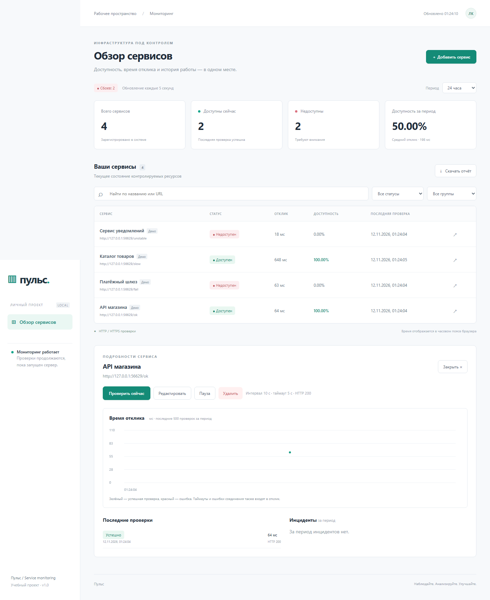
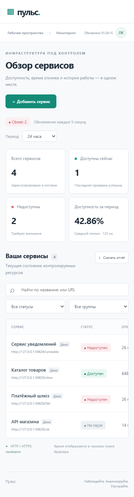
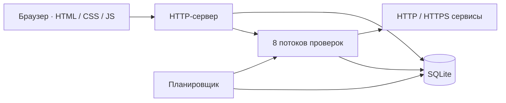

<div align="center">

# Пульс

**Учебный мониторинг доступности сайтов и HTTP API**

[](https://github.com/akiooooo/Service-Monitoring/actions/workflows/tests.yml)


[Запуск](#запуск) · [Соответствие заданию](docs/requirements.md) · [Архитектура](docs/architecture.md) · [API](docs/api.md)

</div>

Небольшое веб-приложение для практики сетевых запросов, фоновых задач и SQLite. Оно периодически проверяет адреса, сохраняет результаты и показывает, какие сервисы доступны, сколько времени занимает ответ и когда происходили сбои.

В основе — стандартная библиотека Python, SQLite и обычный JavaScript. Внешних зависимостей для запуска нет. Проект рассчитан на локальную работу одного пользователя.

## Что реализовано

- Добавление, редактирование и удаление сервисов, группы.
- Поиск по названию и URL, фильтры по статусу и группе.
- Автоматические и ручные HTTP/HTTPS-проверки, пауза.
- Текущий статус, HTTP-код, ошибка и время отклика.
- История проверок, график отклика и открытые/закрытые инциденты.
- Доступность за 24 часа, 7 и 30 дней, отчёт CSV.
- Хранение данных между запусками.


<details>
<summary>Карточка сервиса</summary>



</details>

<details>
<summary>Мобильный экран</summary>



</details>

На скриншотах только локальные демонстрационные сервисы.

## Запуск

Нужен **Python 3.11+**:

```sh
git clone https://github.com/akiooooo/Service-Monitoring.git
cd Service-Monitoring
python run.py
```

Откройте **http://127.0.0.1:8000**. На Windows можно использовать `py -3.13 run.py`, на Linux/macOS — `python3 run.py`. Пакеты из pip устанавливать не нужно. Для остановки нажмите `Ctrl+C`.

При желании создайте виртуальное окружение: `python -m venv .venv`. Для PyCharm откройте папку проекта, выберите Python 3.11+ или локальную `.venv` и запустите `run.py`.

База создаётся автоматически в `data/pulse.db`. Другой порт или база:

```sh
python run.py --port 8080 --db data/another.db
```

Путь к базе можно задать переменной `PULSE_DB`; параметр `--db` имеет приоритет.

## Демонстрация

В первом терминале:

```sh
python scripts/demo.py --seed
```

Во втором:

```sh
python run.py
```

Будут добавлены четыре ресурса: успешный ответ, HTTP 503, медленный ответ и сервис, который меняет состояние каждые 30 секунд. Это реальные локальные проверки, история заранее не генерируется. Повторный `--seed` не дублирует демо-URL. После остановки стенда его сервисы станут недоступны.

[Короткий сценарий для проверки преподавателем](docs/requirements.md#порядок-демонстрации).

## Как работает мониторинг



Планировщик раз в секунду выбирает сервисы, у которых наступило время проверки. Для одного сервиса одновременно выполняется не больше одной проверки. Следующая назначается через заданный интервал после завершения предыдущей; при очереди фактический интервал увеличивается.

Успех — HTTP-код совпал с ожидаемым. Редиректы не выполняются, сертификаты HTTPS проверяются. Время отклика измеряется до получения заголовков, без загрузки тела и выполнения JavaScript. Таймаут не гарантирует строгий предел общей длительности: отдельные сетевые этапы зависят от ОС.

Первый сбой открывает инцидент, первый успешный ответ закрывает его. Пауза останавливает будущие автоматические проверки, но разрешает ручные. При временной ошибке SQLite планировщик пишет ошибку в лог и повторяет чтение расписания.

```text
Доступность = успешные проверки / все проверки за период × 100%
```

Без проверок показывается «—». Общий процент рассчитывается по всем результатам, а не усреднением процентов сервисов. Это доля успешных проверок, не точный SLA по времени. Средний отклик включает и неуспешные попытки. Поиск и фильтры меняют таблицу; карточки и CSV относятся ко всем сервисам за период.

## Проверки

```sh
python -m unittest discover -s tests -v
node --check monitor/static/app.js
```

Серверные тесты используют временные базы и локальные HTTP-серверы, внешние сайты не нужны. Node.js нужен только для проверки синтаксиса, не для работы приложения.

Дополнительно есть проверка интерфейса Chromium: создание, редактирование, удаление, поиск, история, пауза, ручной запуск, CSV и мобильный экран. Зависимости нужны только для этой проверки:

```sh
python -m pip install playwright
python -m playwright install chromium
python scripts/check_ui.py
```

GitHub Actions запускает серверные тесты на Python 3.11–3.13 в Windows и Ubuntu. Подробности и ограничения проверки — в [отчёте](docs/verification.md).

## Файлы проекта

```text
run.py                 запуск и параметры командной строки
monitor/checker.py     HTTP-проверки и планировщик
monitor/database.py    SQLite, результаты и инциденты
monitor/server.py      REST API, валидация и CSV
monitor/static/        интерфейс без сборки
scripts/demo.py        локальные демонстрационные сервисы
scripts/check_ui.py    проверка интерфейса и скриншоты
scripts/package.py     архив для сдачи
tests/                 серверные тесты
docs/                  архитектура, API, требования и проверка
```

## Docker — дополнительный вариант

```sh
docker compose up --build -d
docker compose logs -f
docker compose down
```

Адрес тот же: http://127.0.0.1:8000. База хранится в томе `pulse-data`; обычный `down` сохраняет её, `down -v` удаляет. Адрес `127.0.0.1` внутри контейнера указывает на контейнер, а не на компьютер. Демо-стенд рассчитан на запуск без Docker.

## Ограничения и дальнейшие шаги

Нет авторизации, ролей и уведомлений. API нельзя открывать в интернет: пользователь может запускать запросы к внутренним адресам от имени сервера. Запускайте один экземпляр на одну базу.

История пока не очищается автоматически. Карточка показывает до 500 проверок за период на графике, 50 в списке и 100 инцидентов. Статистика и CSV учитывают все проверки периода. Время хранится в UTC, отображается в часовом поясе браузера. Изменение URL сохраняет старую историю; для отдельной статистики создайте новый сервис.

Ввод проверяется сервером, SQL-запросы параметризованы, пользовательский текст экранируется, CSV защищён от формул. Это не полноценный аудит безопасности и не готовый публичный сервис.

Дальше можно добавить очистку истории, уведомления после нескольких сбоев и авторизацию. Переход на отдельный воркер и PostgreSQL имеет смысл при росте нагрузки.

## Документация

- [Соответствие требованиям](docs/requirements.md).
- [Схема данных и решения](docs/architecture.md).
- [REST API](docs/api.md).
- [Использование ИИ](docs/ai-assistance.md).
- [Как предложить исправление](CONTRIBUTING.md).

Для сборки чистого архива: `python scripts/package.py`. В него входят исходники, задание, тесты и инструкция. Рабочая база, окружение, история Git и логи исключены.

Материалы для изучения: [Python](https://docs.python.org/3/), [urllib.request](https://docs.python.org/3/library/urllib.request.html), [SQLite](https://www.sqlite.org/docs.html), [HTTP на MDN](https://developer.mozilla.org/ru/docs/Web/HTTP).
