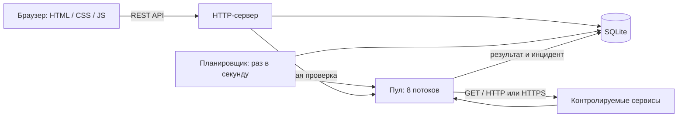
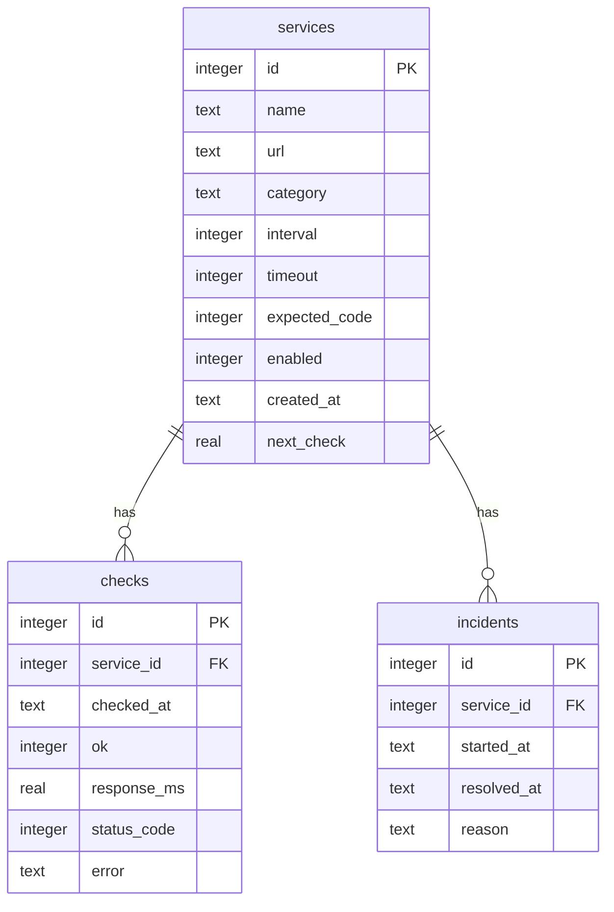

# Архитектура

## Поток данных

Всё работает в одном Python-процессе. HTTP-запросы интерфейса обслуживает `ThreadingHTTPServer`, расписание — отдельный поток, сетевые проверки — `ThreadPoolExecutor`. Новый SQLite connection создаётся на каждую операцию, соединения не передаются между потоками. WAL позволяет читать историю во время записи, ожидание блокировки — до 10 секунд.

## Схема базы

`next_check` — Unix time для планировщика. Даты результатов — ISO 8601 в UTC с миллисекундами. `status_code` отсутствует, если HTTP-ответ не получен. `error` отсутствует при успехе. `resolved_at` отсутствует у открытого инцидента.

Индекс `(service_id, checked_at DESC)` ускоряет выборку истории. Частичный уникальный индекс гарантирует один открытый инцидент на сервис. Удаление сервиса каскадно удаляет результаты и инциденты. Фиксация результата и изменение инцидента происходят в одной транзакции. HTTP-ответ на изменение конфигурации отправляется после commit.

Схема создаётся при первом запуске; версия записывается в `PRAGMA user_version=1`. Полноценного механизма миграций пока нет. Перед изменением схемы нужна резервная копия и отдельная миграция.

## Основные решения

**Без ORM и фреймворка.** Для небольшого приложения достаточно стандартной библиотеки. SQL и обработчики видны напрямую; обратная сторона — маршрутизацию и проверку данных приходится поддерживать вручную.

**SQLite.** Упрощает запуск и перенос проекта. Подходит одному экземпляру и небольшой нагрузке, но запись остаётся последовательной. Для нескольких экземпляров понадобятся другая БД и координация расписания.

**Статус из последней проверки.** В конфигурации не дублируется поле текущего состояния. Пауза имеет приоритет в интерфейсе. До первого результата статус — «Ожидание».

**Инциденты по результатам.** Первый неуспех открывает инцидент, первый успех закрывает. Смена URL не очищает старую историю: для отдельной статистики нового ресурса стоит создать новый сервис. Пауза также не закрывает открытый инцидент.

**Локальные адреса разрешены.** Это нужно для инфраструктурного мониторинга. Доступ к приложению должен оставаться в доверенной среде. По умолчанию сервер слушает только `127.0.0.1`, compose публикует порт только на loopback хоста.

## Ручная проверка перед демонстрацией

1. Запустить демо-стенд с `--seed` и основной сервер.
2. Убедиться, что API доступен, платёжный шлюз недоступен, каталог отвечает медленнее.
3. Открыть сервис уведомлений, дождаться сбоя и восстановления; убедиться, что инцидент закрывается.
4. Изменить группу, найти сервис поиском, проверить фильтры.
5. Включить паузу: автоматические проверки остановятся, ручная останется доступной.
6. Скачать CSV, проверить период и кириллицу.
7. Перезапустить основной сервер: конфигурация и история должны сохраниться.
